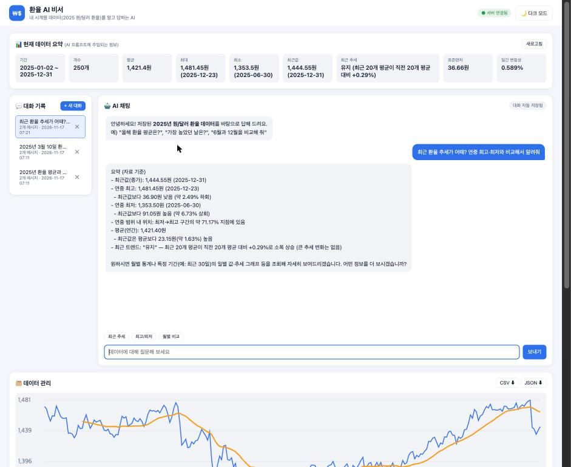
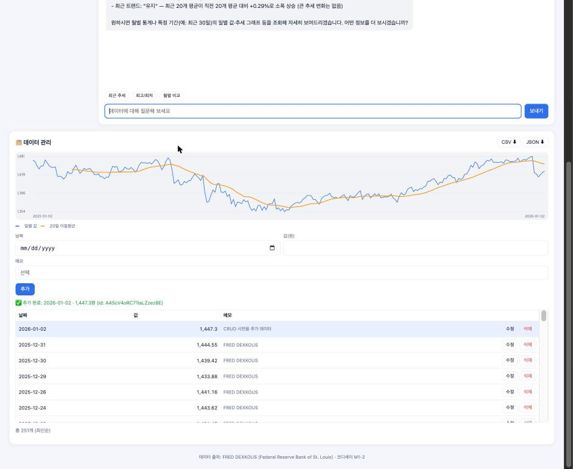
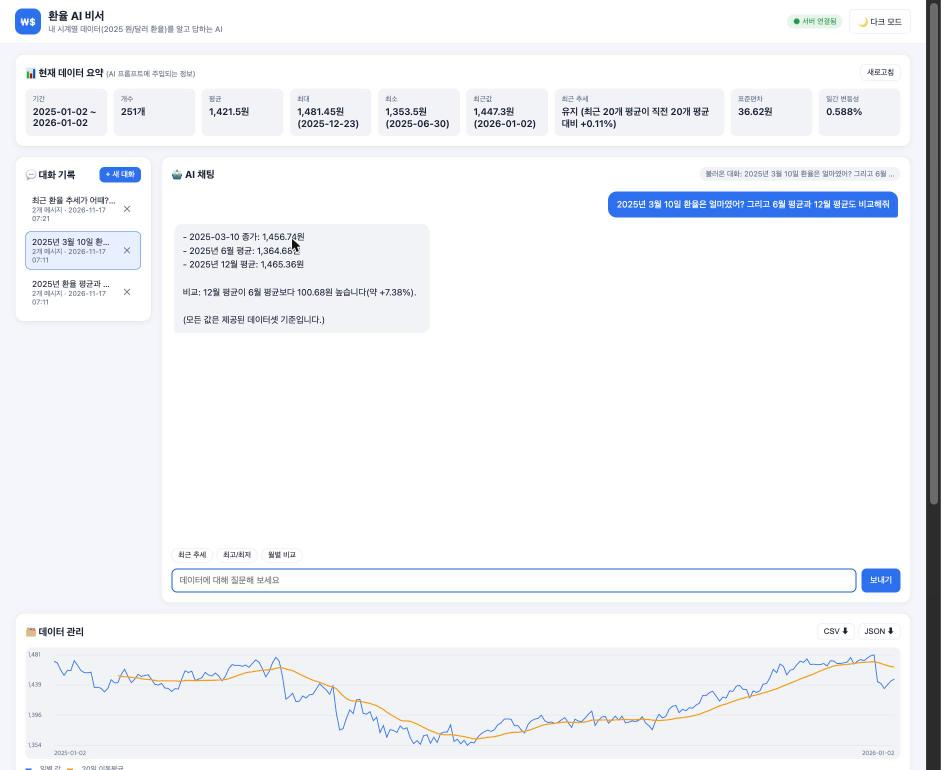
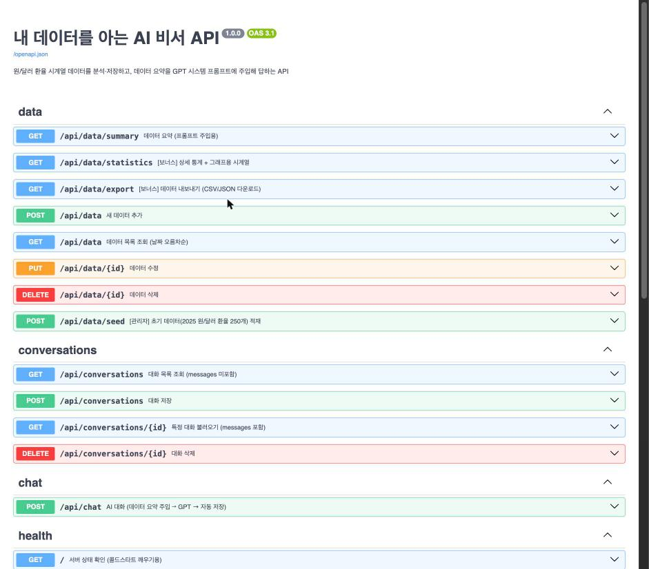
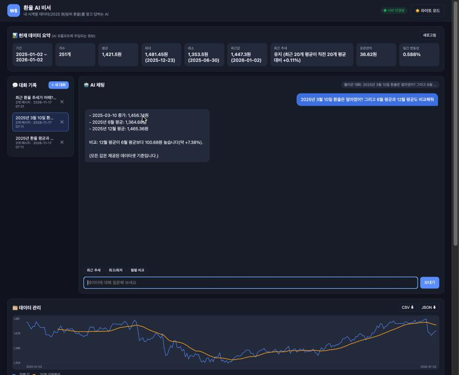

# 💱 환율 AI 비서: 내 데이터를 아는 AI

> 코디세이 M1-2 · AI Agent 개발: 나만의 AI 비서 구축

일반 ChatGPT는 **내 데이터**를 모릅니다. 이 서비스는 직접 고른 시계열 데이터(2025년 원/달러 환율 250일치)를 분석해 **요약 정보**를 만들고, 그 요약을 GPT의 시스템 프롬프트에 **주입(컨텍스트 주입)** 해서 "내 데이터를 알고 답하는 AI 비서"를 만듭니다.

- "올해 평균 환율은?", "가장 높았던 날은?", "6월과 12월을 비교해 줘" 같은 질문에 **저장된 데이터 기준으로** 답합니다.
- 데이터를 추가·수정·삭제하면 요약이 즉시 다시 계산되어 AI 답변에도 반영됩니다.
- 대화는 Firestore에 자동 저장되고, 이전 대화를 불러와 이어서 대화할 수 있습니다.

---

## 🔗 배포 URL

| 구분 | URL |
|---|---|
| 프론트엔드 (Vercel) | https://m1-2-fx-ai-assistant.vercel.app |
| 백엔드 API (Render) | https://m1-2-fx-ai-backend.onrender.com |
| Swagger UI (API 문서) | https://m1-2-fx-ai-backend.onrender.com/docs |

> ⏳ 백엔드는 Render **무료 플랜**이라 15분 동안 요청이 없으면 잠듭니다. 첫 접속은 **최대 1분** 걸릴 수 있습니다.
> 프론트엔드는 접속하면 `GET /`로 서버를 먼저 깨우고, 늦어지면 상단에 "서버 깨우는 중" 안내 배너를 보여 줍니다.

---

## 🧰 기술 스택

| 영역 | 사용 기술 |
|---|---|
| 백엔드 | Python 3.11, **FastAPI**, Uvicorn, **Pydantic v2** (요청 검증) |
| DB | **Firebase Firestore** (`firebase-admin`) |
| AI | **GPT API** (`openai` SDK, Chat Completions + Function Calling), 모델 `gpt-5-mini` (코디세이 제공 OpenAI 호환 서버 `OPENAI_BASE_URL`) |
| 프론트엔드 | **HTML / CSS / JavaScript (바닐라, 프레임워크 없음)**, Canvas 그래프 |
| 배포 | 백엔드 **Render** (Web Service), 프론트 **Vercel** |
| 설정 | `python-dotenv` (.env), 환경 변수로 키 관리 |

---

## 📊 데이터 선정과 분석

- **데이터**: 원/달러 환율 (1달러당 원화, 일별), 출처 **FRED `DEXKOUS`** (Federal Reserve Bank of St. Louis)
- **기간 / 개수**: 2025-01-02 ~ 2025-12-31, **250개** (미국 공휴일 결측치 제외), 조건인 100개 이상을 충족합니다.
- 파일: [`backend/data/usdkrw_2025.csv`](backend/data/usdkrw_2025.csv) (`date, value, memo`)

**요약 정보(`GET /api/data/summary`)** 를 만드는 방법 ([`analysis.py`](backend/app/services/analysis.py))

| 항목 | 계산 방법 |
|---|---|
| 기간 `period` | 가장 이른 날짜 ~ 가장 늦은 날짜 |
| 개수 `count` | 레코드 수 |
| 기본 통계 `metrics` | 합계, 평균, 최대(날짜), 최소(날짜), 최근값(날짜) |
| 추세 `trend` | **최근 20개 평균과 직전 20개 평균을 비교**: +0.5% 초과면 상승, -0.5% 미만이면 하락, 그 사이면 유지 |

응답 예시 (초기 데이터 250개 기준)

```json
{
  "period": "2025-01-02 ~ 2025-12-31",
  "count": 250,
  "metrics": {
    "total": 355349.08, "average": 1421.4,
    "max": 1481.45, "max_date": "2025-12-23",
    "min": 1353.5,  "min_date": "2025-06-30",
    "latest": 1444.55, "latest_date": "2025-12-31"
  },
  "trend": "유지 (최근 20개 평균이 직전 20개 평균 대비 +0.29%)",
  "description": "원/달러 환율(1달러당 원화, 일별 종가 기준, 출처: FRED DEXKOUS)",
  "unit": "원"
}
```

---

## 🏗️ 프로젝트 구조

```
M1-2/
├── backend/                      # FastAPI (Render 배포, Root Directory = backend)
│   ├── main.py                   # 앱 생성, CORS 설정, 라우터 등록
│   ├── requirements.txt          # fastapi, uvicorn, firebase-admin, openai, python-dotenv
│   ├── .env.example              # 환경 변수 예시 (실제 .env는 커밋 금지)
│   ├── app/
│   │   ├── config.py             # 환경 변수 읽기 (키 하드코딩 금지)
│   │   ├── firebase.py           # Firestore 연결 (서비스 계정 키 = 환경 변수)
│   │   ├── schemas.py            # Pydantic 요청/응답 모델 (입력 검증)
│   │   ├── routers/              # "어떤 URL로 요청을 받는가" (HTTP 계층)
│   │   │   ├── data.py           #   /api/data (CRUD + summary)
│   │   │   ├── conversations.py  #   /api/conversations
│   │   │   └── chat.py           #   /api/chat
│   │   └── services/             # "실제로 무슨 일을 하는가" (비즈니스 로직)
│   │       ├── analysis.py       #   요약/통계 계산 (순수 함수)
│   │       ├── data_service.py   #   data 컬렉션 CRUD
│   │       ├── conversation_service.py  # conversations 컬렉션
│   │       └── chat_service.py   #   컨텍스트 주입 + GPT 호출 + 자동 저장
│   ├── data/usdkrw_2025.csv      # 초기 데이터 250개
│   └── scripts/seed_data.py      # 초기 데이터를 Firestore에 넣는 스크립트
└── frontend/                     # 바닐라 HTML/CSS/JS (Vercel 배포, Root Directory = frontend)
    ├── index.html / styles.css / app.js
    ├── config.js                 # 로컬용 API 주소
    ├── build.js                  # Vercel 빌드 시 환경 변수 API_BASE_URL → config.js 생성
    └── vercel.json
```

**라우터/서비스로 나눈 기준**
- **routers**: URL·HTTP 메서드·상태 코드·요청/응답 모델만 담당합니다. (얇게 유지)
- **services**: DB 읽기/쓰기, 통계 계산, GPT 호출 같은 실제 로직을 담당합니다.
- **analysis.py**는 DB와 무관한 순수 계산 함수라 따로 테스트할 수 있고, `/api/data/summary`와 `/api/chat`이 **같은 함수**를 재사용합니다.

---

## 🗄️ Firestore 컬렉션 구조

```
data (컬렉션)                       conversations (컬렉션)
└─ {자동 ID}                          └─ {자동 ID}
   ├─ date: "2025-12-31"  (문자열)       ├─ title: "올해 평균 환율은?"
   ├─ value: 1444.55      (숫자)         ├─ messages: [ {role:"user", content:"..."},
   ├─ memo: "FRED DEXKOUS"                │              {role:"assistant", content:"..."} ]
   ├─ created_at / updated_at            ├─ created_at
                                          └─ updated_at
```
- 날짜를 `YYYY-MM-DD` 문자열로 저장하면 문자열 정렬이 곧 날짜 정렬이 되어 `order_by("date")`로 시계열 순서대로 조회할 수 있습니다.
- 시계열이므로 **같은 날짜는 1개만** 허용합니다. 중복이면 `409 Conflict`를 돌려줍니다.

---

## 🔌 API 명세 (Swagger: `/docs`)

### 데이터 API (CRUD 4 + summary 1)
| 메서드 | 경로 | 설명 |
|---|---|---|
| POST | `/api/data` | 새 데이터 추가 `{date, value, memo}` → 201 |
| GET | `/api/data` | 목록 조회 (날짜 오름차순, `?start=&end=&limit=` 선택) |
| PUT | `/api/data/{id}` | 수정 (보낸 필드만 변경, 최소 1개) |
| DELETE | `/api/data/{id}` | 삭제 → 204 |
| GET | `/api/data/summary` | **요약 (프롬프트 주입용)** |

### 대화 기록 API
| 메서드 | 경로 | 설명 |
|---|---|---|
| POST | `/api/conversations` | 대화 저장 `{title?, messages[]}` |
| GET | `/api/conversations` | 대화 목록 (**messages 미포함**, `message_count`만 제공) |
| GET | `/api/conversations/{id}` | **(A) 방식**: 특정 대화의 전체 messages 조회 → "대화 불러오기" |
| DELETE | `/api/conversations/{id}` | 대화 삭제 |

### AI 챗봇 API
| 메서드 | 경로 | 설명 |
|---|---|---|
| POST | `/api/chat` | `{message, conversation_id?}` → `{reply, conversation_id, summary, tools_used}` |

**`/api/chat` 동작 흐름** ([`chat_service.py`](backend/app/services/chat_service.py))
1. 데이터 요약 조회 (`/api/data/summary`와 같은 `get_summary()` 함수)
2. 요약을 **시스템 프롬프트에 삽입**
3. GPT API 호출 (이어지는 대화면 이전 메시지 최근 10개를 함께 전달)
4. 질문과 답변을 `conversations`에 **자동 저장** (새 대화면 생성, 기존 대화면 이어 붙임)

```text
당신은 데이터 분석 비서입니다.

[데이터 설명]
- 원/달러 환율(1달러당 원화, 일별 종가 기준, 출처: FRED DEXKOUS) / 단위: 원

[사용자 데이터 요약]
- 데이터 기간: {period}
- 총 레코드: {count}개
- 주요 지표: 합계 …, 평균 …, 최대 … (날짜), 최소 … (날짜), 최근값 … (날짜)
- 최근 트렌드: {trend}

위 데이터를 기반으로 맞춤형 답변을 제공하세요.
```

### 보너스 API
| 메서드 | 경로 | 설명 |
|---|---|---|
| GET | `/api/data/statistics` | 표준편차, 일간 변동률·변동성, **월별 평균/최대/최소**, 20일 이동평균 시계열 |
| GET | `/api/data/export?format=csv\|json` | 데이터 내보내기 (파일 다운로드) |
| POST | `/api/data/seed` | (관리자) 초기 데이터 250개 적재, `X-Admin-Token` 헤더 필요 |

---

## ✅ 입력 검증 (Pydantic)과 예외 처리

| 상황 | 결과 |
|---|---|
| `date`가 날짜 형식이 아님 (`"2025-13-40"`) | 422 |
| `value`가 0 이하이거나 숫자가 아님 (`-5`, `"abc"`) | 422 |
| `memo` 200자 초과, 채팅 `message` 빈 문자열이거나 1000자 초과 | 422 |
| PUT 본문이 비어 있음 `{}` | 422 ("최소 1개는 보내야 합니다") |
| 없는 id 수정·삭제·조회 | 404 |
| 같은 날짜 중복 추가 | 409 |
| Firebase 키 누락 / OpenAI 키 누락 | 503 (원인 메시지 포함) |
| GPT 호출 실패 | 502 |

검증을 라우터에 들어오기 **전에** Pydantic이 처리하므로 잘못된 데이터가 DB에 들어가지 않고, 서비스 코드는 "올바른 값"만 다루면 됩니다.

---

## 🔐 환경 변수 (최소 세트)

### 백엔드 (Render → Environment)
| 변수 | 필수 | 설명 |
|---|---|---|
| `OPENAI_API_KEY` | ✅ | GPT API 키 |
| `FIREBASE_SERVICE_ACCOUNT_JSON` | ✅ (배포) | 서비스 계정 키 **JSON 파일 내용 전체** |
| `FIREBASE_SERVICE_ACCOUNT_PATH` | ✅ (로컬) | 서비스 계정 키 파일 경로 (위 JSON 대신 사용) |
| `ALLOWED_ORIGINS` | ✅ | CORS 허용 도메인, 쉼표로 구분 (예: `https://xxx.vercel.app,http://127.0.0.1:5500`) |
| `OPENAI_BASE_URL` | 선택 | OpenAI 호환 서버를 쓸 때만 |
| `OPENAI_MODEL` | 선택 | 기본값 `gpt-4o-mini` |
| `OPENAI_MAX_TOKENS` | 선택 | 응답 토큰 상한 (기본 800, **과금 방지**) |
| `USE_TOOLS` | 선택 | Function Calling 사용 여부 (기본 `true`) |
| `ADMIN_TOKEN` | 선택 | `/api/data/seed` 보호용 토큰 |
| `PYTHON_VERSION` | 선택 | Render Python 버전 (예: `3.11.9`) |

### 프론트엔드 (Vercel → Environment Variables)
| 변수 | 설명 |
|---|---|
| `API_BASE_URL` | 백엔드 주소 (예: `https://xxx.onrender.com`). 빌드 때 `build.js`가 `config.js`로 만들어 넣음 |

> 실제 키 값은 `.env`(로컬) 또는 Render/Vercel 대시보드에만 넣고, **GitHub에는 절대 올리지 않습니다.** `.gitignore`에 `.env`, `*serviceAccount*.json`, `*firebase-adminsdk*.json`을 등록했습니다.

---

## 💻 로컬 실행 방법

### 0) 준비물
- Python **3.10 이상**, Git
- Firebase 프로젝트의 **서비스 계정 키 JSON** (Firebase 콘솔 → 프로젝트 설정 → 서비스 계정 → 새 비공개 키 생성)
- OpenAI API 키

### 1) 백엔드
```bash
git clone https://github.com/youjinni11/M1-2.git
cd M1-2/backend

python3 -m venv venv               # 가상환경 만들기
source venv/bin/activate           # (Windows: venv\Scripts\activate)
pip install -r requirements.txt

cp .env.example .env               # .env를 열어 OPENAI_API_KEY 등 입력
# 서비스 계정 키 파일을 backend/serviceAccountKey.json 으로 저장

python -m scripts.seed_data        # (최초 1회) 환율 250개를 Firestore에 적재
uvicorn main:app --reload          # http://127.0.0.1:8000/docs 에서 Swagger 확인
```

### 2) 프론트엔드 (새 터미널)
```bash
cd M1-2/frontend
python3 -m http.server 5500        # http://127.0.0.1:5500 접속
```
`frontend/config.js`의 기본 API 주소가 `http://127.0.0.1:8000`이라 로컬 백엔드에 바로 연결됩니다.

---

## 🚀 배포 방법

### 백엔드: Render
1. New → **Web Service** → GitHub `youjinni11/M1-2` 연결
2. **Root Directory** `backend` / Runtime **Python 3**
3. Build Command `pip install -r requirements.txt`
4. Start Command `uvicorn main:app --host 0.0.0.0 --port $PORT`
5. Region **Singapore** (Firestore 위치 `asia-southeast1`과 같은 지역), Instance Type **Free**, Environment에 위 환경 변수 입력 → Deploy
6. `https://<서비스>.onrender.com/docs` 에서 Swagger 확인 → 초기 데이터 적재
   - `POST /api/data/seed` (헤더 `X-Admin-Token`) 또는 로컬에서 `python -m scripts.seed_data`
   - 공개 저장소를 URL로 연결했기 때문에 코드 변경 후에는 Render에서 **Manual Deploy → Deploy latest commit** 으로 재배포

> **트러블슈팅 (실제로 겪은 문제)**: 배포 직후 Firestore 호출이 `403 Missing or insufficient permissions`로 실패했습니다.
> 원인은 Firebase 서비스 계정(`firebase-adminsdk-fbsvc@…`)에 프로젝트 IAM 역할이 붙지 않은 것이었고,
> Google Cloud 콘솔 → IAM에서 **Firebase Admin SDK 관리자 서비스 에이전트** + **Cloud Datastore 사용자** 역할을 부여해 해결했습니다.
> 이 과정에서 Firestore 오류가 500 대신 원인이 담긴 **503 JSON**으로 응답하도록 예외 처리기를 추가했습니다.

### 프론트엔드: Vercel
1. Add New → Project → `youjinni11/M1-2` Import
2. **Root Directory** `frontend` (빌드 설정은 `vercel.json`이 자동 적용: `node build.js` → `dist`)
3. Environment Variables에 `API_BASE_URL` = Render 주소 → Deploy
4. 배포된 Vercel 주소를 Render의 `ALLOWED_ORIGINS`에 추가 (CORS)

---

## 🖼️ 제출 스크린샷

### 1. 데이터 요약이 보이는 채팅 화면 (질문 + 답변)
상단에 프롬프트에 주입되는 **데이터 요약**(기간·개수·평균·최대·최소·추세)이 보이고, AI가 그 값을 근거로 답합니다.


### 2. 데이터 관리 화면 (추가 동작)
`2026-01-02 / 1,447.3원` 데이터를 화면에서 **추가** → "추가 완료" 메시지 + 목록 맨 위에 강조 표시 + 요약·그래프 즉시 갱신(250개 → 251개).


### 3. 대화 기록 화면 (불러오기 동작)
왼쪽 목록에서 이전 대화를 클릭하면 `GET /api/conversations/{id}`로 전체 메시지를 다시 표시합니다. (상단 "불러온 대화: …")


### 4. Swagger UI (`/docs`)


### 5. [보너스] 다크 모드 + 그래프


---

## ⭐ 보너스 구현

### 1) 인사이트·UX 고도화 (전부 구현)
- **추가 지표**: `GET /api/data/statistics`에서 표준편차, 일간 평균 변동률, 일간 변동성, 월별 평균/최대/최소를 제공합니다. 요약 카드에 표준편차·변동성을 표시합니다.
- **시각화**: Canvas로 일별 환율과 **20일 이동평균** 선 그래프를 그립니다. (라이브러리 없이 직접 구현)
- **내보내기**: CSV / JSON 다운로드 버튼 (`/api/data/export`)
- **다크 모드** 토글 (브라우저에 설정 기억)

### 2) AI 도구 호출 (Function Calling)
GPT에게 아래 4개 도구의 스키마를 알려 주고, GPT가 **필요하다고 판단할 때만** 호출하게 했습니다.

| 도구 | 호출 근거 (GPT가 이 도구를 고르는 상황) | 내부 동작 |
|---|---|---|
| `get_data_summary` | 데이터를 방금 수정했거나 최신 요약이 필요할 때 | `data_service.get_summary()` |
| `get_monthly_statistics` | "6월과 12월 비교", "변동이 컸던 달"처럼 **월 단위** 질문 | `get_statistics()` (월별 통계) |
| `get_data_records` | "3월 10일 환율은?"처럼 **특정 날짜·기간** 질문 (요약에 없는 값) | 기간 필터 목록 조회 (최대 60개) |
| `list_recent_conversations` | "전에 내가 뭘 물어봤지?" | 대화 목록 조회 |

**호출 흐름**
```
사용자 질문 ─▶ /api/chat
   ① 요약 조회 → 시스템 프롬프트 주입
   ② GPT 호출 (tools 스키마 포함)
   ③ GPT가 tool_calls 반환? ─ 아니오 ─▶ 답변 완료
            │ 예
            ▼
      서버가 해당 함수 실행 → 결과(JSON)를 role:"tool" 메시지로 다시 전달
            │ (최대 3회 반복, 마지막 라운드는 도구 없이 → 무한 호출/과금 방지)
            ▼
   ④ 최종 답변 + 사용한 도구 목록(tools_used) → conversations 자동 저장
```
화면의 AI 답변 아래에 `🔧 사용한 도구: …`가 표시되어 어떤 도구를 근거로 답했는지 확인할 수 있습니다.

**실제 검증 예시 (배포 서버)**
- 질문: "2025년 3월 10일 환율은 얼마였어? 그리고 6월 평균과 12월 평균도 비교해줘"
- 요약에는 특정 날짜·월별 값이 없으므로 GPT가 `get_data_records`(3/10 원본값) → `get_monthly_statistics`(월 평균)를 **스스로 선택해 호출**
- 답변: 3/10 종가 1,456.74원, 6월 평균 1,364.68원, 12월 평균 1,465.36원 → 원본 CSV로 계산한 값과 일치함을 확인
도구 호출을 지원하지 않는 서버를 쓰면 자동으로 도구 없이 다시 요청합니다.

> MCP Server / GPT Actions 연동은 이번 제출 범위에 포함하지 않았습니다.

---

## 💸 비용/보안 메모
- `OPENAI_MAX_TOKENS`(기본 800)로 응답 길이를 제한하고, 이전 대화는 최근 10개 메시지만 전달하며, 도구 호출은 최대 3회로 제한합니다.
- 서비스 계정 키·API 키는 환경 변수로만 관리합니다. `/api/data/seed`는 `ADMIN_TOKEN` 헤더가 맞을 때만 동작합니다.
- CORS는 `ALLOWED_ORIGINS`에 등록한 도메인(배포된 Vercel 주소, 로컬 주소)만 허용합니다.
